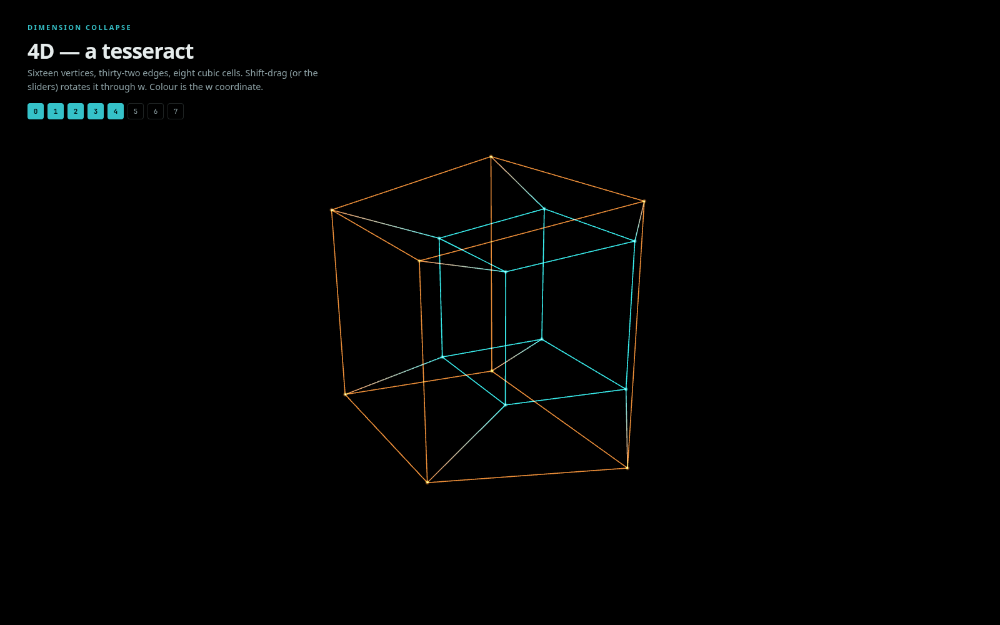

# dimension-collapse

**Interactive web animation: building 0D → 7D, then collapsing 7D back down to a single point.**
Three.js + GSAP. Working title.

Black screen → a point → a segment → a square → a cube → a tesseract → 5-, 6-, 7-cube → and back down,
one dimension at a time, to a single point held in silence. The final hold mirrors the opening black screen:
full circle. Each collapse is one rep.



## Who it is for

People with the spatial-intuition disconnect — who can follow the algebra of higher dimensions but cannot
_see_ it. Counter-intuition is trainable through repeated exposure. The animation is built as a rep you can
run again and again, and it is honest about where pictures stop: beyond 4D the spatial tricks run out, and
the endpoint is the jump from drawing to trusting matrices and patterns, the way a linear algebra course does.

## Quick start

```bash
npm install
npm run dev        # http://localhost:5173 — plays the full 0 → 7 → 0 sequence, looping
npm test           # Vitest: geometry core, timeline, frame computation
npm run build      # static site in dist/
```

No build step at all? Open **`prototype/index.html`** directly in a browser. It is a condensed single-file port
that pulls Three.js and GSAP from a CDN via an import map (so it needs network, but no server).

## Controls

| Input                            | Action                                                          |
| -------------------------------- | --------------------------------------------------------------- |
| Drag                             | Orbit the 3D camera (scroll to zoom)                            |
| **Shift + drag** (or right-drag) | Rotate the object through the fourth dimension (xw / yw planes) |
| Sliders `xw` `yw` `zw`           | Rotate through w with precise angles                            |
| Space                            | Play / pause                                                    |
| ← / →                            | Previous / next stage                                           |
| `R`                              | Reset w-rotation                                                |
| `P`                              | Toggle the side panel                                           |
| `?`                              | Help                                                            |
| Transport bar                    | Scrub the timeline, change speed, toggle loop                   |

**What the colours mean.** Hue is the **w** coordinate (teal = −1, amber = +1); below 4D it is the coordinate
currently being built or collapsed, so colour drains out as an axis disappears. Brightness is the fifth
coordinate **v**. Everything beyond that is perspective — one scale factor per extra axis — plus the live
rotation matrix in the side panel.

URL parameters: `?paused=1`, `?loop=0`, `?t=30` (start time in seconds), `?stage=net-flat`
(stage ids are in `src/timeline/sequence.js`), `?headless=1` (used by the trailer renderer).

## The sequence

| Stage       | What you see                                                                               | What it is                                                                                                                   |
| ----------- | ------------------------------------------------------------------------------------------ | ---------------------------------------------------------------------------------------------------------------------------- |
| black       | nothing                                                                                    | no basis vectors                                                                                                             |
| 0D → 3D     | point, segment, square, cube                                                               | each step: copy the shape, slide the copy along a new axis, connect every corner to its twin — the same rule, one more layer |
| 3D → 4D     | the tesseract, then a full turn in the xw plane                                            | the rotating projection; colour = w                                                                                          |
| **the net** | eight cubes unfold into a flat cross, hold, and fold back up                               | the tesseract's 8 cubic cells laid out as a 3D "paper template"                                                              |
| 4D → 7D     | nested, colour- and brightness-coded wireframes; spins in planes that involve the new axes | 32 / 64 / 128 vertices; the picture becomes a code and the matrix takes over                                                 |
| 7D → 0D     | each axis collapses in turn; twin vertices merge                                           | projection along one basis vector at a time                                                                                  |
| hold        | a single point, then fade to black                                                         | the image of all 128 vertices; one rep done                                                                                  |

The whole thing takes about 90 seconds at 1×.

## Project structure

```
index.html                 app shell (HUD markup)
src/
  main.js                  bootstrap, render loop, headless API (window.__dc)
  state.js                 the single state object GSAP tweens and the renderer reads
  geometry/
    ncube.js               n-cube vertices/edges, two-copies recursion
    rotation.js            Givens rotations, composition, orthonormality checks
    projection.js          n → 3 perspective / orthographic
    net.js                 tesseract net: 8 cells + fold
  scene/
    frame.js               pure: state → projected positions + colour parameters
    colors.js              hue mapping
    view.js                Three.js renderer, fat-line wireframes, orbit camera
  timeline/sequence.js     the GSAP master timeline (all stages, captions, timings)
  ui/hud.js                stage labels, pips, sliders, Shift-drag, matrix panel, transport
  audio/sonification.js    experimental Web Audio hook (off by default)
prototype/index.html       single-file CDN version
scripts/render-trailer.mjs Puppeteer → PNG frames → ffmpeg MP4
tests/                     Vitest
docs/                      the math (Markdown + LaTeX)
```

Design: the object on screen is always an n-cube whose axes have per-axis _extents_. Axes below the current
dimension have extent 1, the "frontier" axis has extent 0..1, axes above have 0. Building tweens the
frontier's extent 0 → 1 and snaps the dimension up; collapsing snaps it down and tweens 1 → 0. The snap
happens where the two copies coincide, so it is invisible — but the counts, pips and labels change
discretely, because you either have a basis vector or you don't.

## The math

See [`docs/`](docs/README.md):

- [n-cube](docs/ncube.md) — $2^n$ vertices, $n\,2^{n-1}$ edges, the recursion and the "corner placement" framing
- [rotation](docs/rotation.md) — Givens rotations in coordinate planes; why 4D has six planes, three of them new
- [projection](docs/projection.md) — perspective division per extra dimension, and why we use the product form
- [collapse](docs/collapse.md) — the collapse as a projection; why discrete steps; what each visual channel encodes
- [net](docs/net.md) — how the eight-cube net is constructed and folded

## Rendering the trailer

The live web version is the artifact. The MP4 is a shareable trailer of it.

```bash
npm run dev                        # in one terminal
npm run render:trailer             # in another → render/trailer.mp4 (1920×1080, 30 fps)

# or let the script start its own server, and render a slice:
npm run render:trailer -- --serve --from 16 --to 40 --fps 24 --width 1280 --height 720
```

Requirements: a Chrome/Chromium binary (`puppeteer-core` does not download one — pass `--chrome <path>`, set
`CHROME_PATH`, or `npm i -D puppeteer` for the zero-config route) and `ffmpeg` on `PATH`. Without ffmpeg the PNG
frames are kept and the exact ffmpeg command is printed. Frames are rendered deterministically by seeking the
GSAP timeline, so the output does not depend on machine speed.

## Roadmap

Implemented: the 0 → 7 → 0 sequence, interactive camera, rotation through w (drag + sliders), colour-mapping by w,
brightness by v, tesseract net unfolding, live basis matrix, scrubbing, headless MP4 rendering.

Stubbed / next:

- **Sound** — `src/audio/sonification.js` is a tiny Web Audio prototype (each axis = one harmonic partial of a
  110 Hz tone; w-rotation detunes the w partial). Off by default; toggle in the panel. Treat as a hook, not a design.
- **Slicing** — 3D cross-sections drifting through the 4D object like a CT scan (`w = c` plane sweeping).
- **Vertex trails** — fading ghost ribbons behind vertices during rotation.
- **Timeline-as-w** — scrub w directly instead of time.
- **Opacity-as-dimension** — currently brightness (identical on black); true per-vertex alpha would need a custom line shader.
- **Trailer** — a published MP4, and possibly a GitHub Pages deploy of the live version.
- More nets (there are 261 tesseract nets), cell shading, touch gestures for w-rotation.

## Development

```bash
npm run lint           # ESLint (flat config)
npm run format         # Prettier
npm run test:watch
```

Node ≥ 20. No framework; plain ES modules.

## License

MIT © 2026 Victor (MKlolbullen). See [LICENSE](LICENSE).
